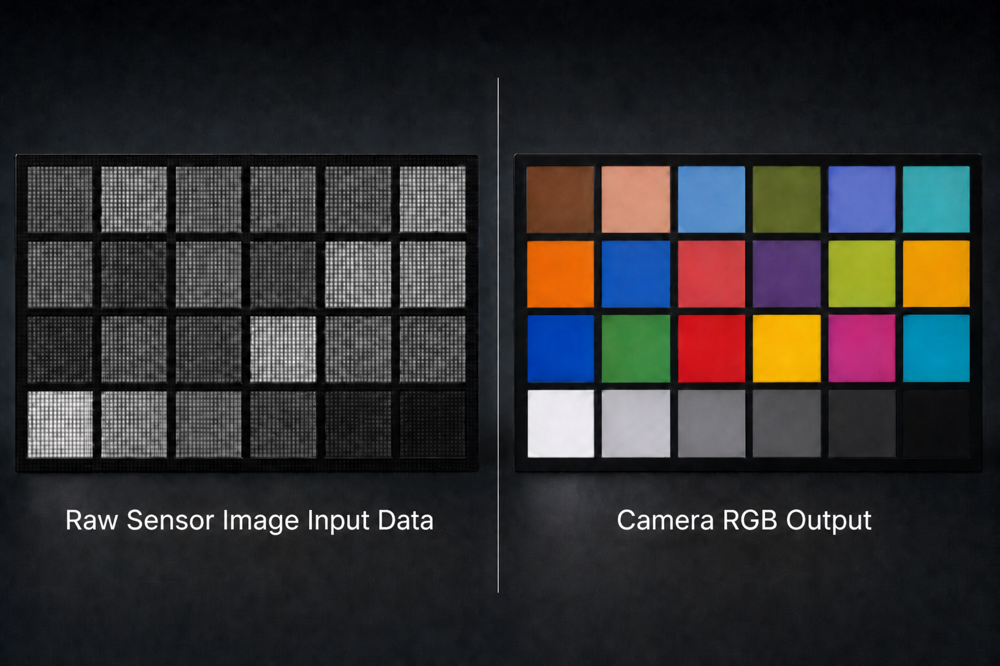
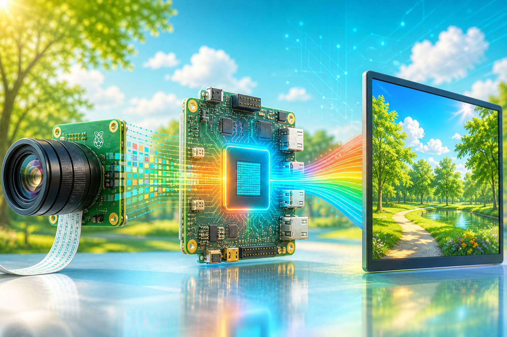

# ISP-based Camera Lite Solution System Example Designs for Agilex® Devices

## Overview

This repository contains projects demonstrating how to create and build
ISP-based Camera Lite Solution Example Designs, using Altera®'s [Video and Vision Processing (VVP) Suite IP cores](https://www.altera.com/products/ip/po-3150/video-and-vision-processing-suite),
and targetting [Altera® Agilex® devices](https://www.altera.com/fpga).

The projects are stored in individual folders, classified by device families and target devkits.

---

## 4Kp30 Camera Lite Solution System Example Design

| | |
|---|---|
| **Target device family** | [Agilex® 3](https://www.altera.com/products/fpga/agilex/3) and [Agilex® 5E](https://www.altera.com/products/fpga/agilex/5/e-series) |
| **Development kit** | [Agilex® 3 FPGA and SoC C-Series Development Kit](https://www.altera.com/products/devkit/po-3000/agilex-3-fpga-and-soc-c-series-development-kit) and [Agilex® 5 FPGA E-Series 013B Development Kit](https://www.altera.com/products/devkit/po-3196/agilex-5-fpga-e-series-013b-development-kit) |
| **Quartus® tool** | [Altera® Quartus® Prime Pro Edition version 26.1.1](https://www.altera.com/downloads/fpga-development-tools/quartus-prime-pro-edition-design-software-version-26-1-1-linux) |
| **Control plane** | [Nios® V Processor](https://www.altera.com/products/ip/po-3098/nios-v-processors) with a bare-metal software application |
| **Precompiled SOF** | [agilex3_golden_4k_isp_lite_ed.sof](https://github.com/altera-fpga/agilex3-ed-camera/releases/download/rel-26.1.1/agilex3_golden_4k_isp_lite_ed.sof) and [agilex5_golden_4k_isp_lite_ed.sof](https://github.com/altera-fpga/agilex3-ed-camera/releases/download/rel-26.1.1/agilex5_golden_4k_isp_lite_ed.sof) |
| **Quartus Project** | [agilex3c_a3w135b-dk_4k-isp-lite-ed.zip](https://github.com/altera-fpga/agilex3-ed-camera/releases/download/rel-26.1.1/agilex3c_a3w135b-dk_4k-isp-lite-ed.zip) and [agilex5e_a5e013b-dk_4k-isp-lite-ed.zip](https://github.com/altera-fpga/agilex3-ed-camera/releases/download/rel-26.1.1/agilex5e_a5e013b-dk_4k-isp-lite-ed.zip) |
| **Source Code** | [Source Code for the Agilex® 3 ED Variant](https://github.com/altera-fpga/agilex3-ed-camera/tree/rel/26.1.1/agilex3c-ed/a3w135b-dk/4k-isp-lite-ed) and [Source Code for the Agilex® 5 ED Variant](https://github.com/altera-fpga/agilex3-ed-camera/tree/rel/26.1.1/agilex5e-ed/a5e013b-dk/4k-isp-lite-ed) |
| **User Guide** | [Documentation for the Agilex® 3 ED Variant](https://github.com/altera-fpga/agilex3-ed-camera/blob/rel/26.1.1/agilex3c-ed/a3w135b-dk/4k-isp-lite-ed/docs/doc-camera-lite.md) and [Documentation for the Agilex® 5 ED Variant](https://github.com/altera-fpga/agilex3-ed-camera/blob/rel/26.1.1/agilex5e-ed/a5e013b-dk/4k-isp-lite-ed/docs/doc-camera-lite.md) |

 

  

---

## CSI Camera to DSI Display Solution System Example Design

| | |
|---|---|
| **Target device family** | [Agilex® 3](https://www.altera.com/products/fpga/agilex/3) and [Agilex® 5E](https://www.altera.com/products/fpga/agilex/5/e-series) |
| **Development kit** | [Agilex® 3 FPGA and SoC C-Series Development Kit](https://www.altera.com/products/devkit/po-3000/agilex-3-fpga-and-soc-c-series-development-kit) and [Agilex® 5 FPGA E-Series 013B Development Kit](https://www.altera.com/products/devkit/po-3196/agilex-5-fpga-e-series-013b-development-kit) |
| **Quartus® tool** | [Altera® Quartus® Prime Pro Edition version 26.1.1](https://www.altera.com/downloads/fpga-development-tools/quartus-prime-pro-edition-design-software-version-26-1-1-linux) |
| **Control plane** | [Nios® V Processor](https://www.altera.com/products/ip/po-3098/nios-v-processors) with a bare-metal software application |
| **Precompiled SOF** | [agilex3_golden_4k_csi_dsi_ed.sof](https://github.com/altera-fpga/agilex3-ed-camera/releases/download/rel-26.1.1/agilex3_golden_4k_csi_dsi_ed.sof) and [agilex5_golden_4k_csi_dsi_ed.sof](https://github.com/altera-fpga/agilex3-ed-camera/releases/download/rel-26.1.1/agilex5_golden_4k_csi_dsi_ed.sof) |
| **Quartus Project** | [agilex3c_a3w135b-dk_4k-csi-dsi-ed.zip](https://github.com/altera-fpga/agilex3-ed-camera/releases/download/rel-26.1.1/agilex3c_a3w135b-dk_4k-csi-dsi-ed.zip) and [agilex5e_a5e013b-dk_4k-csi-dsi-ed.zip](https://github.com/altera-fpga/agilex3-ed-camera/releases/download/rel-26.1.1/agilex5e_a5e013b-dk_4k-csi-dsi-ed.zip) |
| **Source Code** | [Source Code for the Agilex® 3 ED Variant](https://github.com/altera-fpga/agilex3-ed-camera/tree/rel/26.1.1/agilex3c-ed/a3w135b-dk/4k-csi-dsi-ed) and [Source Code for the Agilex® 5 ED Variant](https://github.com/altera-fpga/agilex3-ed-camera/tree/rel/26.1.1/agilex5e-ed/a5e013b-dk/4k-csi-dsi-ed) |
| **User Guide** | [Documentation for the Agilex® 3 ED Variant](https://github.com/altera-fpga/agilex3-ed-camera/blob/rel/26.1.1/agilex3c-ed/a3w135b-dk/4k-csi-dsi-ed/docs/index.md) and [Documentation for the Agilex® 5 ED Variant](https://github.com/altera-fpga/agilex3-ed-camera/blob/rel/26.1.1/agilex5e-ed/a5e013b-dk/4k-csi-dsi-ed/docs/index.md) |

 

  

---

