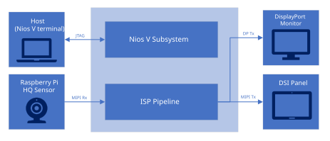
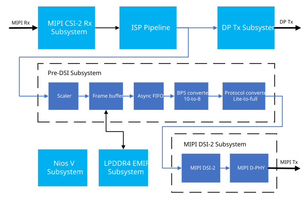
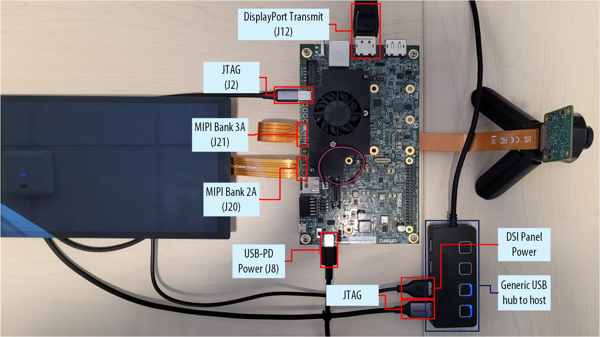
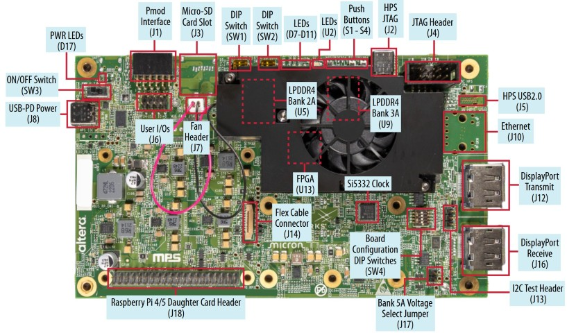
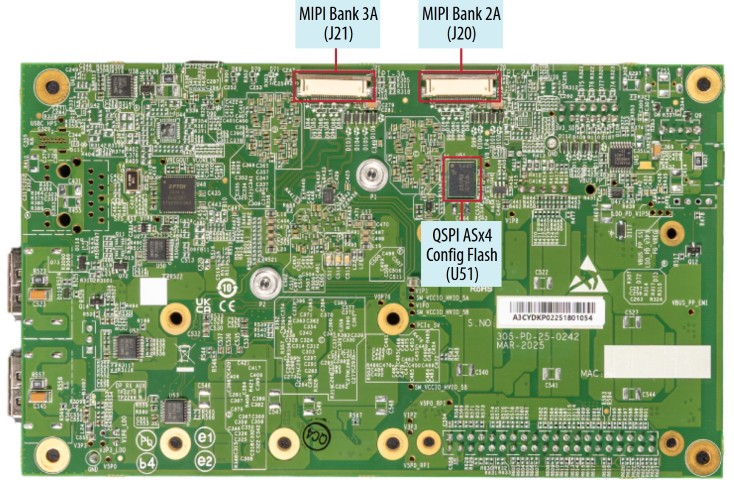
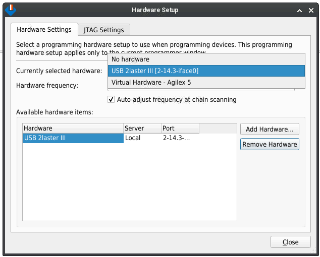
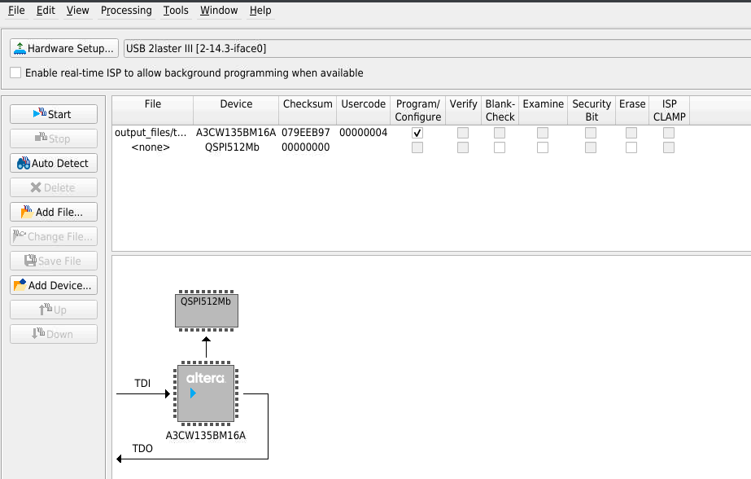
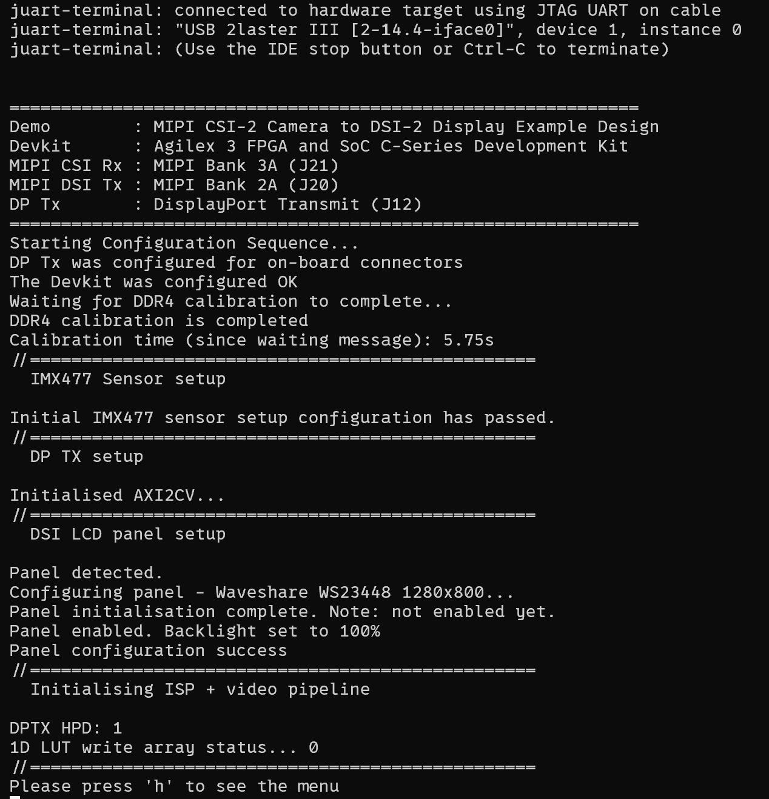

# MIPI CSI-2 Camera to DSI-2 Display Example Design for Agilex® 3

## Overview

The MIPI® CSI-2™ Camera to DSI-2™ Display Example Design for Agilex® 3 extends the
[4k30 Camera Lite Example Design](https://github.com/altera-fpga/agilex3-ed-camera/tree/rel/26.1.1/agilex3c-ed/a3w135b-dk/4k-csi-dsi-ed/),
adding a secondary Mobile Industry Processor Interface (MIPI)
Display Serial Interface 2 (DSI-2) + MIPI D-PHY™ Tx output, which mirrors the main camera stream. This design serves as a full MIPI
Camera Serial Interface 2 (CSI-2) Rx to MIPI DSI-2 Tx reference.

The MIPI interface supports up to 2.5Gbps per lane and up to 8x lanes per MIPI interface, enabling
seamless data reception from a 4K image sensor to the FPGA fabric for further processing. The MIPI
CSI-2 IP instance converts pixel data to AXI4-Streaming outputs, enabling connectivity to other IP
cores within Altera®'s Video and Vision Processing (VVP) Suite.

For full details about the main Image Sensor Processing (ISP) pipeline, refer to the "Camera Lite
Example Design" documentation [here][camera-lite-docs-link].

## Features

This example design demonstrates:
- Camera ingest via MIPI CSI-2 + D-PHY
- A basic Image Sensor Processing (ISP) pipeline
- MIPI DSI-2 + D-PHY Output
- DisplayPort™ Output

### DSI-2 subsystem

A video switch is used to duplicate the output after "Output processing" subsystem, which feeds a "Pre-DSI subsystem"
that downscales and buffers the input from 3840x2160p30 to 1280x800p60.

## Pre-requisites

### Hardware requirements

* [Agilex 3 FPGA and SoC C-Series Development Kit][devkit-link]
* USB-PD Type-C® power adapter (for powering the development kit)
    - A typical USB-C® laptop charger fits this requirement
* [Raspberry Pi® High Quality Camera][rpi-cam-buy-link] (package comes with corresponding MIPI CSI cable)
    * Use a mount and lens of your choice. The important part is the Sony IMX477 image sensor that comes with the camera.
* [Tripod](https://thepihut.com/products/small-tripod-for-raspberry-pi-hq-camera)
* [Waveshare® 8-inch 1280x800 DSI LCD panel][dsi-panel-buy-link] (package comes with corresponding MIPI DSI cable)
* USB-IF certified USB-C 3.2 Gen cable (for JTAG-over-USB)
    - This specific requirement guarantees high-quality data lane shielding for maximum JTAG signal integrity 
* Charge-only USB-C cable (for the Waveshare DSI LCD panel)
* 4K DisplayPort™ Monitor
* DisplayPort cable

### Software requirements

- Altera Quartus® Prime Pro version 26.1.1 (with Nios® V command-line tools)
- Device Support for Agilex 3

## Getting Started

### Compiling the design

Open the project `top.qpf` in Quartus Prime Pro 26.1.1, and click "Compile Design". This process takes roughly 40 minutes to 1 hour.

A bitstream will be produced at `output_files/top.sof`.

### Setting up the development kit

1) Configure the Agilex 3 FPGA and SoC C-Series Development Kit switches and jumpers to their
factory default settings, as per the user guide [instructions][devkit-ug-default].

2) Connect the following items to the development kit
    - USB-PD Type-C power adapter to J8
    - Waveshare LCD DSI panel via corresponding MIPI CSI cable to J21
    - Raspberry Pi Camera via corresponding MIPI DSI cable J20
    - Host laptop via USB-C 3.2 cable to J2
    - Monitor/TV via DisplayPort cable to J12

3) Connect a charge-only USB-C cable from any power supply or host (like a laptop or USB hub)
to the Waveshare LCD DSI panel.
    - The panel requires 5W at 0.5A, which is supported on any USB-C host.

**Note**: The design is robust against missing input and output camera/display connections. A test pattern will be used in place of the camera if the camera is missing.

An example setup is shown in the image below. A generic USB hub was used to serve both as power for the Waveshare LCD DSI panel, and as a JTAG-over-USB connection to the host.

These Board Reference codes align with the following diagrams from the [User Guide][devkit-ug-comps].

### Programming the FPGA

1) Ensure your development kit is switched on.

2) Open Programmer (via already open project, or standalone via `quartus_pgmw`/`quartus_pgmw.exe`)

3) Click "Hardware Setup", and ensure the development kit is visible (via USB Blaster III) and selected.

4) Click "Auto Detect", selecitng "Yes" to any messages about mismatched device chains.

5) Select the "A3CW135BM16A" device, click "Change File" and select `output_files/top.sof`.

6) Check the "Program/Configure" box on the "A3CW135BM16A" device.

Your Programmer window should look like this:

Click "Start". If Programmer fails, check that you have no running instances of `juart-terminal`.

### Controlling the demo

After the FPGA has been programmed, use the following commands to open up a terminal for controlling the demo.

- Linux:
    - `juart-terminal --device 1 --instance 0`
    - If `juart-terminal` is not found, ensure `$QUARTUS_ROOTDIR/bin` is available on `PATH`.
- Windows: `juart-terminal.exe --device 1 --instance 0`
    - If `juart-terminal.exe` is not found, ensure `%QUARTUS_ROOTDIR%/bin` (for 32-bit installations) or `%QUARTUS_ROOTDIR%/bin64` (for 64-bit installations) is available on `PATH`.
    - Or run manually at the specified location.

On success, your terminal should look similar to the image below:

## Project Structure

`top.sv` is the top-level file.

`src/` mostly contains version controlled source files. Exceptions include directories under `src/ip/dp_tx_phy/`,
as Quartus automatically generates files directly next to .ip files, and directories at `src/vds/*/.qsys_edit`.
- `src/custom_ip` contains custom, non-official IP used for the design. Typically small blocks with corresponding
`_hw.tcl` files for VDS discovery.
- `src/ip` contains standalone IP files, created outside of VDS.
- `src/vds` contains VDS and related IP files
- `src/sw` contains files related to the Nios V software.
  - `src/sw/app` contains the software soruce code
  - `src/sw/mem_init` contains the precompiled software, initialised into the Nios V's main memory at startup.
- `sdc/` contains .sdc files. These are added in the main `top.qsf`.
- `qsf/` contains child .qsf files, sourced by the main `top.qsf`.

`gen/` contains build artifacts, namely generated VDS files (under `gen/vds`) and possibly software
build artifacts (under `gen/sw`) if you are recompliling the software.

`scripts/` contains helper scripts if you are modifying the design. These do not need to be
used if you are simply compiling and running the design as-is.

The directories `dni`, `qdb` and `tmp-clearbox` are standard Quartus databases/artifacts generated during compilation.

## Modifying the design

After modifying the design, the precompiled software will no longer be valid.
Use the command `quartus_py scripts/build_niosv_sw.py` to recompile the software.
This will update the .hex file used to initialise the software's main memory.
A number of script arguments are available; use the command `quartus_py scripts/build_niosv_sw.py --help` for details.

VDS system scripts are provided as a means of backup.
Use the command `quartus_py scripts/recreate_vds_systems.py` to restore all VDS systems to their original state.

## References and Useful Links
- Agilex 3 FPGA and SoC C-Series Development Kit [Product Page][devkit-link] and [User Guide][devkit-ug]
- Vision and Video Processing Suite IP [Product Page][vvp-product] and [User Guide][vvp-ug]
- [MIPI Product Page][mipi-product]
- [MIPI D-PHY IP User Guide][dphy-ug]
- [MIPI DSI-2 IP User Guide][dsi2-ug]
- [MIPI CSI-2 IP User Guide][csi2-ug]
- Nios V Processor [Product Page][niosv-product] and [Software Developer Handbook][niosv-ug]
- [Altera Streaming Video Protocol Specification](https://docs.altera.com/r/docs/683397/current/altera-streaming-video-protocol-specification/)

## Notices and Disclaimers

Altera Corporation technologies may require enabled hardware, software or service activation.
No product or component can be absolutely secure. Performance varies by use, configuration
and other factors. Your costs and results may vary. You may not use or facilitate the
use of this document in connection with any infringement or other legal analysis concerning
Altera products described herein. You agree to grant Altera Corporation a non-exclusive,
royalty-free license to any patent claim thereafter drafted which includes subject matter
disclosed herein. No license (express or implied, by estoppel or otherwise) to any
intellectual property rights is granted by this document, with the sole exception that you
may publish an unmodified copy. You may create software implementations based on this document
and in compliance with the foregoing that are intended to execute on the Altera product(s)
referenced in this document. No rights are granted to create modifications or derivatives of this
document. The products described may contain design defects or errors known as errata which may
cause the product to deviate from published specifications. Current characterized errata are
available on request. Altera disclaims all express and implied warranties, including without
limitation, the implied warranties of merchantability, fitness for a particular purpose, and
non-infringement, as well as any warranty arising from course of performance, course of dealing,
or usage in trade. You are responsible for safety of the overall system, including compliance with
applicable safety-related requirements or standards.

&copy; Altera Corporation.

Altera, the Altera logo, and other Altera marks are trademarks of Altera Corporation or its subsidiaries.

MIPI is a registered trademark of MIPI Alliance, Inc.
CSI-2, DSI-2 and D-PHY™ are trademarks of MIPI Alliance, Inc.

USB Type-C and USB-C are registered trademarks of USB Implementers Forum.
USB 2.0 Type-C and USB Power Delivery are trademarks of USB Implementers Forum.

Raspberry Pi is a trademark of Raspberry Pi Ltd.

All other trademarks and registered trademarks are the property of their respective owners.

<!-- definitions -->
[panel-link]: test
[camera-lite-docs-link]: https://altera-fpga.github.io/rel-26.1.1/embedded-designs/agilex-3/c-series/camera/camera_lite_4k30/camera_4k/#camera-lite-video-pipeline-functional-description
[dsi-panel-buy-link]: https://www.waveshare.com/8inch-dsi-lcd-c.htm
[rpi-cam-buy-link]: https://www.raspberrypi.com/products/raspberry-pi-high-quality-camera/
[devkit-link]: https://www.altera.com/products/devkit/po-3000/agilex-3-fpga-and-soc-c-series-development-kit
[devkit-ug]: https://docs.altera.com/r/docs/851698/current/agilex-3-fpga-and-soc-c-series-development-kit-user-guide
[devkit-ug-default]: https://docs.altera.com/r/docs/851698/current/agilex-3-fpga-and-soc-c-series-development-kit-user-guide/default-settings
[devkit-ug-comps]: https://docs.altera.com/r/docs/851698/current/agilex-3-fpga-and-soc-c-series-development-kit-user-guide/development-kit-components
[vvp-ug]: https://docs.altera.com/r/docs/683329/current/
[dsi2-ug]: https://docs.altera.com/r/docs/869461/current/
[dphy-ug]: https://docs.altera.com/r/docs/817561/current
[csi2-ug]: https://docs.altera.com/r/docs/813926/current/
[niosv-ug]: https://docs.altera.com/r/docs/743810/current/
[mipi-product]: https://www.altera.com/products/ip/po-3062/mipi-d-phy-ip
[vvp-product]: https://www.altera.com/products/ip/po-3150/video-and-vision-processing-suite
[niosv-product]: https://www.altera.com/products/ip/po-3098/nios-v-processors
