# 4Kp30 Camera Lite System Example Design for Agilex® Devices

---

## Contents

* [Functional Description](#functional-description)
* [ISP Ingest](#isp-ingest)
* [ISP Processing](#isp-processing)
* [Output Processing](#output-processing)
* [Return to the Main User Guide](./doc-camera-lite.md#functional-description)

---

## Functional Description

The 4Kp30 Camera Lite Example Design ingests video through an industry-standard MIPI interface connected directly to the sensor. The design processes the raw sensor video data through an Image Signal Processing (ISP) pipeline, and then outputs the result through DisplayPort (DP). The design also runs an embedded bare-metal software application on a Nios® V soft processor.

The following block diagram shows the main components and subsystems of the Camera Lite system example design.

  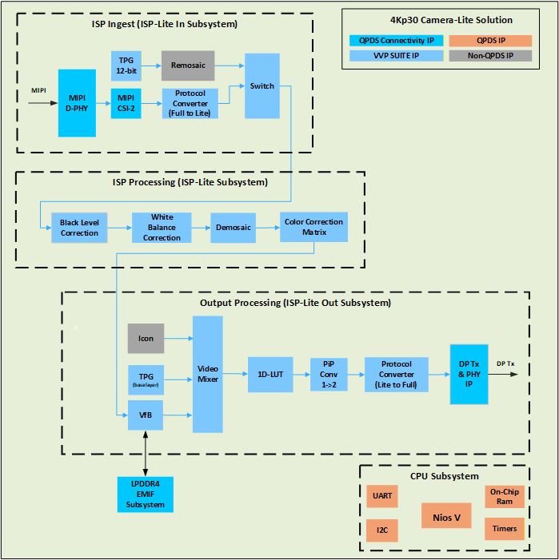
   <em>4Kp30 Camera Lite Example Design—Top Block Diagram</em>

The remainder of this section describes each subsystem in the example design and the internal components of those subsystems.

---

## ISP Ingest

The ISP pipeline ingests video from a Raspberry Pi High Quality (HQ) Camera module. The Raspberry Pi HQ Camera provides a two-lane MIPI interface that runs at a maximum of 2400 Mbps per lane. The optical sensor for the Raspberry Pi HQ Camera module is a Sony IMX477 device that outputs a Color Filter Array (CFA) image, also known as a Bayer image. The sensor can support up to UHD 4K resolution at 30 frames per second (FPS), with 12 bits per pixel.

  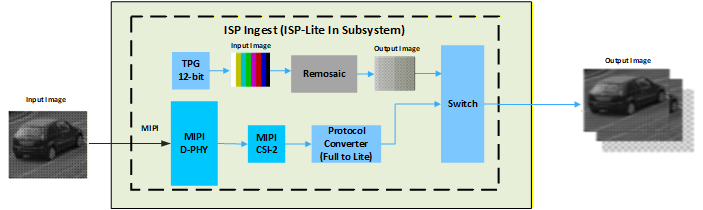
   <em>ISP Ingest Block Diagram</em>

A CFA is typically a 2×2 mosaic of tiny colored filters—usually red, green, and blue—placed over a monochromatic image sensor so that each photosite captures a single color. The CFA typically contains twice as many green filters as red or blue filters, which aligns with human vision being more sensitive to light in the yellow-green part of the spectrum. The following example shows a typical RGGB (red, green, green, blue) CFA pattern that repeats over the entire image. In this example, the image is an 8×8 array. Pixels arrive left to right and top to bottom as alternating red and green pixels on the first line, and then alternating green and blue pixels on the next line. This pattern repeats on the next pair of lines, and so on. Using single-color pixels reduces the overall bandwidth requirements of the sensor.

  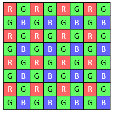
   <em>8×8 RGGB Color Filter Array (Bayer) Image Example</em>

A demosaic algorithm rebuilds the full-color image. In the CFA domain, four color channels exist. In the RGGB example, the channels are red, green1, green2, and blue. Any given pixel belongs to only one of these color channels. Each color channel is sometimes referred to as a CFA phase.

The Altera® MIPI D-PHY IP interfaces the FPGA directly to the Raspberry Pi HQ Camera module through a MIPI cable. The design showcases a 4K (3840×2160) sensor that can process images at up to 30 FPS using 12-bit Bayer pixel samples. The MIPI D-PHY is configured for one link of ×2 lanes at 1500 Mbps, which provides sufficient bandwidth, with no skew calibration and non-continuous clock mode. The sensor module includes additional pins, including a power-enable pin and a slave I²C interface for powering and configuring the camera. The power-enable pin connects to an Altera Parallel Input/Output (PIO) IP that has an Avalon® memory-mapped agent interface for runtime control from the Nios® V soft processor. The I²C interface connects through an I²C controller. When the software application starts, it powers the camera and configures it for 1500 Mbps lane speed, 3840×2160 resolution, RAW12 pixel samples, no skew calibration, and blanking for 30 FPS.

The design connects an Altera® MIPI CSI-2 IP to the MIPI D-PHY IP receive link using a two-lane, 16-bit PHY Protocol Interface (PPI) bus. The design configures the CSI-2 IP output at one pixel in parallel (PiP) using a 297 MHz clock and minimal internal buffering. Because the ISP IP cores support only the VVP AXI4-Stream Lite protocol, a VVP Protocol Converter IP converts the CSI-2 IP output.

The input Test Pattern Generator (TPG) IP allows you to test the ISP portion of the design without a connected sensor module. The path uses the VVP Test Pattern Generator IP and a non-QPDS remosaic (RMS) IP that is supplied with the source project. The TPG produces an RGB output, which the ISP IP cores cannot process because those cores support only CFA images. The remosaic IP converts the RGB image into a CFA image by discarding color information for pixels according to the CFA phase supported by the sensor. The TPG supports several modes, including color bars and solid colors. The VVP Switch IP selects the input source between the MIPI CSI-2 receive path and the input TPG.

#### Related Information

* [Test Pattern Generator IP](https://docs.altera.com/r/docs/683329/25.1/video-and-vision-processing-suite-ip-user-guide/test-pattern-generator-ip)
* [Switch IP](https://docs.altera.com/r/docs/683329/25.1/video-and-vision-processing-suite-ip-user-guide/switch-ip)

## ISP Processing

This section summarizes the ISP processing functions and IP cores used in the Camera Lite system example design.

  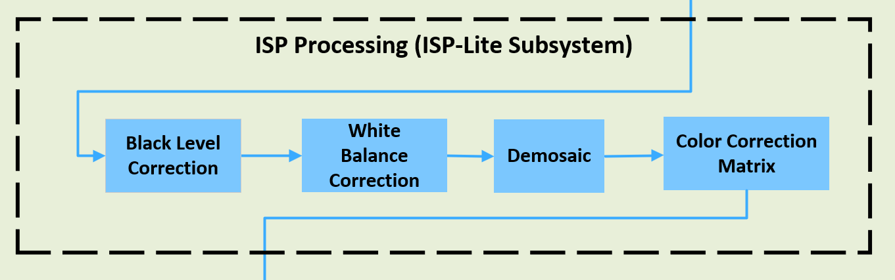
   <em>ISP Processing Block Diagram</em>

The Black Level Correction (BLC) IP operates on a 2×2 CFA input image and adjusts the minimum brightness level of the image so that true black is represented by the minimum pixel intensity. A camera system typically adds a pedestal value as an offset to the image at the sensor. Artificially increasing the black level creates foot room that helps preserve the noise distribution of black pixels and helps prevent artifacts in the final image.

  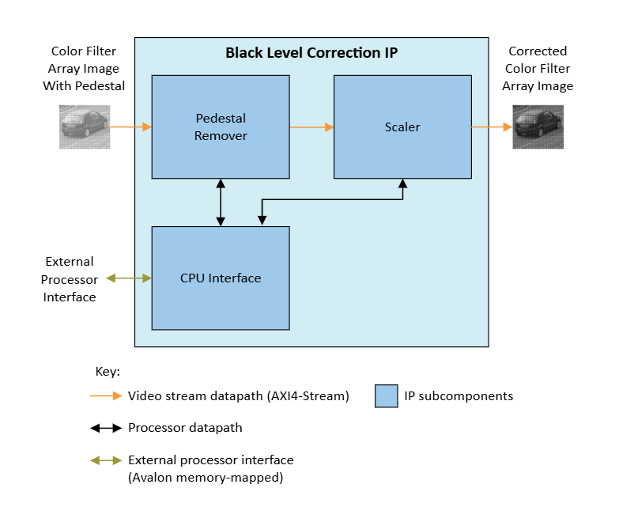
   <em>Black Level Correction Block Diagram</em>

The BLC IP subtracts the pedestal value from the input video stream and scales the result back to the full dynamic range. The scaler multiplies the pedestal-removed value by the scaler coefficient and clips to the maximum output pixel value if the calculation overflows.

  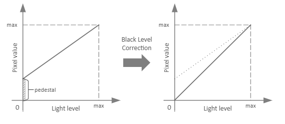
   <em>BLC Function</em>

The software application sets the pedestal and scaler coefficients for each of the 2×2 CFA color channels dynamically at runtime. You can pre-calibrate these values, or you can calculate them dynamically from statistics obtained from the Black Level Statistics (BLS) IP using the Optical Black Region (OBR) of the sensor. You can configure the BLC IP to reflect negative values around zero or to clip them to zero.

For this example design, the BLS IP is not included. The software application relies on pre-calibrated coefficients as a function of the sensor analog gain.

  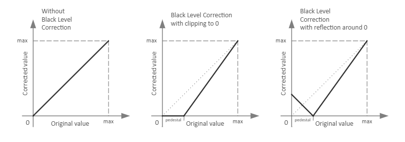
   <em>Effects of Reflection Around Zero</em>

#### Related Information

* [Black Level Correction IP](https://docs.altera.com/r/docs/683329/25.1/video-and-vision-processing-suite-ip-user-guide/black-level-correction-ip)

The White Balance Correction (WBC) IP adjusts colors in a CFA image to eliminate color casts that occur because of lighting conditions or differences in the light sensitivity of pixels of different colors. The IP helps ensure that gray and white objects appear truly gray and white, without unwanted color tinting.

  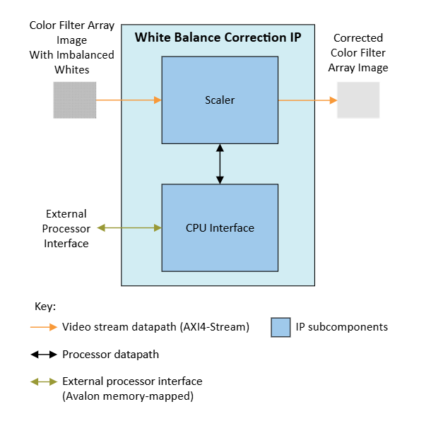
   <em>White Balance Correction Block Diagram</em>

The WBC IP multiplies the color channels of a 2×2 CFA input image by scalar coefficients for each color channel and clips to the maximum output pixel value if the calculation overflows.

The design provides a table of WBC scalars that are pre-calibrated for the sensor across a range of color temperatures. The white-balance algorithm in the software application uses the color temperature of the scene to look up WBC scalars from the calibration table and configures the WBC IP over the Avalon® memory-mapped interface.

#### Related Information

* [White Balance Correction IP](https://docs.altera.com/r/docs/683329/25.1/video-and-vision-processing-suite-ip-user-guide/white-balance-correction-ip)

The Demosaic IP (DMS) is a color reconstruction IP that converts a 2×2 Bayer CFA input image to an RGB output image. The Demosaic IP interpolates missing colors for each pixel based on neighboring pixels.

  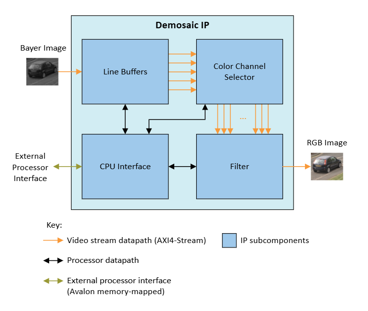
   <em>Demosaic Block Diagram</em>

The Demosaic IP analyzes the neighboring pixels for every CFA input pixel and interpolates the missing colors to produce an RGB output pixel. The IP uses line buffers to construct pixel neighborhood information, maps the pixels in the neighborhood according to their position in the 2×2 CFA pattern, and interpolates the missing colors to calculate the RGB output.

  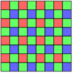
   <em>Example of a 2×2 RGGB Bayer Color Filter Array (8×8 Pixel Section)</em>

#### Related Information

* [Demosaic IP](https://docs.altera.com/r/docs/683329/25.1/video-and-vision-processing-suite-ip-user-guide/demosaic-ip)

The Color Correction Matrix (CCM) function is provided by the VVP Color Space Converter (CSC) IP. CCM correction is necessary to compensate for undesired color bleeding across CFA color channels on the sensor. This bleeding occurs mainly because each colored pixel is sensitive to portions of the spectrum other than its intended color.

The design configures the CSC IP to multiply the input RGB values of each pixel by a 3×3 CCM to obtain the color-corrected output RGB values. The design provides a table of CCM coefficients that are pre-calibrated for the sensor across a range of color temperatures.

#### Related Information

* [Color Space Converter IP](https://docs.altera.com/r/docs/683329/25.1/video-and-vision-processing-suite-ip-user-guide/color-space-converter-ip)

## Output Processing

The output processing side of the video pipeline adjusts colorimetry and combines an overlay with the final ISP 4K output before the DisplayPort transmit (DP Tx) IP.

  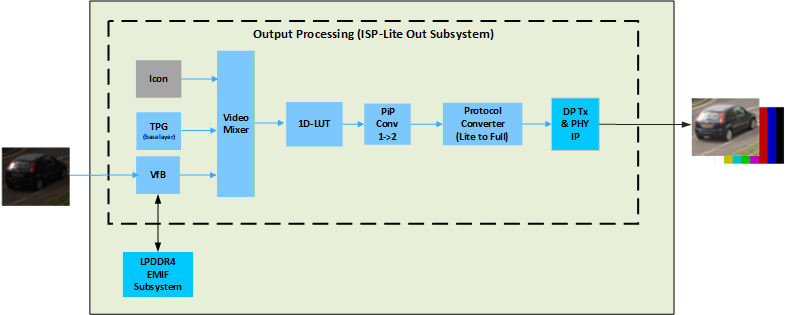
   <em>Output Processing Subsystem</em>

The Video Mixer combines three input images into a single 4K output image. The three input images come from the following IP cores:

* A VVP Test Pattern Generator IP
* A VVP Video Frame Buffer IP
* A non-QPDS Icon IP that is supplied with the source project

The TPG is the base layer for the Mixer IP. By default, the TPG is configured as a 4K solid black image. This base layer also serves as a screensaver function that you can use to test the DisplayPort output.

The video buffer provides the image from the ISP ingest and processing path. The Nios® V processor does not have access to the video data in this buffer. The video buffer is implemented with a VVP Frame Buffer IP and an external LPDDR4 SDRAM through an external memory interface (EMIF). The buffer is used for video synchronization because the sensor ingest path cannot accept sufficient back pressure.

The mixer combines the base layer with the video buffer output image (ISP output image) and the Altera® logo overlay image. The software application can change the global opacity of the icon overlay at runtime.

#### Related Information

* [Test Pattern Generator IP](https://docs.altera.com/r/docs/683329/25.1/video-and-vision-processing-suite-ip-user-guide/test-pattern-generator-ip)
* [Video Frame Buffer IP](https://docs.altera.com/r/docs/683329/25.1/video-and-vision-processing-suite-ip-user-guide/video-frame-buffer-ip)
* [Mixer IP](https://docs.altera.com/r/docs/683329/25.1/video-and-vision-processing-suite-ip-user-guide/mixer-ip)

The 1D LUT IP uses a runtime-configurable look-up table (LUT) to apply a transfer function to the image. You can use the IP to implement OOTF, OETF, and EOTF transfer functions defined for video standards, and to implement legacy gamma compression or decompression. You can also change the LUT content for other transfer functions or to apply an artistic effect to the image.

  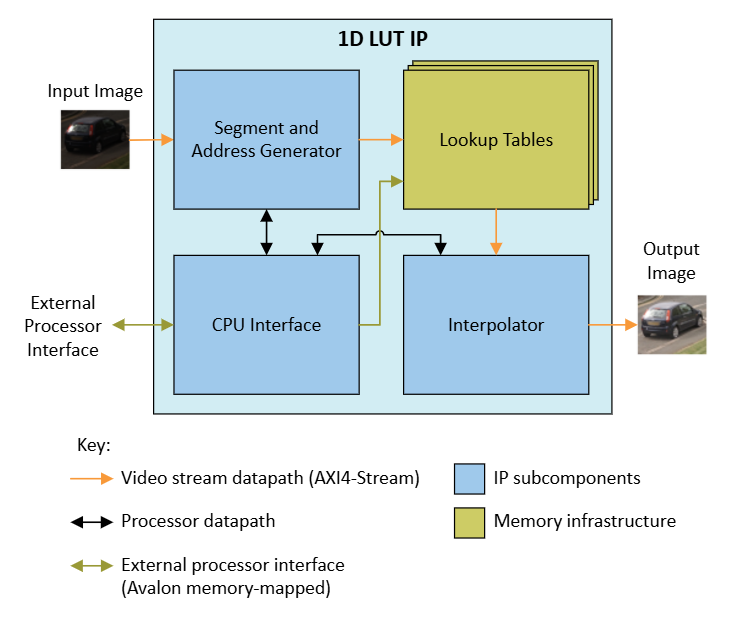
   <em>1D LUT Block Diagram</em>

The 1D LUT IP calculates LUT addresses from the input pixels and interpolates fractional differences between LUT values to generate output pixel values. The IP uses an independent LUT for each color plane. The software application configures the LUTs through the Avalon® memory-mapped interface.

In this design, the 1D LUT provides traditional gamma correction. The 1D LUT is configured as a 9-bit LUT, and the output is increased to 10 bits to match the DisplayPort transmit IP that follows. The DisplayPort transmit function is provided by the Altera® DisplayPort connectivity IP. The DisplayPort IP is configured to support DisplayPort 1.4 with ×4 lanes at 8.1 Gbps, which is sufficient for 4Kp30 10-bit RGB. The DisplayPort IP also supports the VVP AXI4-Stream Full protocol interface. Because the DisplayPort IP does not support one PiP or the VVP AXI4-Stream Lite protocol, the output from the 1D LUT passes through a VVP PiP Converter IP and then a VVP Protocol Converter IP.

#### Related Information

* [1D LUT IP](https://docs.altera.com/r/docs/683329/25.1/video-and-vision-processing-suite-ip-user-guide/about-the-1d-lut-ip)
* [Pixels in Parallel Converter IP](https://docs.altera.com/r/docs/683329/25.1/video-and-vision-processing-suite-ip-user-guide/pixels-in-parallel-converter-ip)
* [Protocol Converter IP](https://docs.altera.com/r/docs/683329/25.1/video-and-vision-processing-suite-ip-user-guide/protocol-converter-ip)
---

[Return to the Main User Guide](./doc-camera-lite.md#functional-description)
