# 4Kp30 Camera Lite System Example Design for Agilex® Devices

This design is compatible with
[Altera® Quartus® Prime Pro Edition software version 26.1.1](https://www.altera.com/downloads/fpga-development-tools/quartus-prime-pro-edition-design-software-version-26-1-1-linux).

> **Important:** This document contains hyperlinks to related documentation. Figures and screenshots are examples. The hardware and software that you observe may differ slightly from the figures in this document.

---

## Contents

* [Overview](#overview)
* [Features and Specifications](#features-and-specifications)
* [Prerequisites](#prerequisites)
* [Getting Started](#getting-started)
* [Testing the Example Design on the Development Kit](#testing-the-example-design-on-the-development-kit)
* [Compiling the Example Design from Scratch](#compiling-the-example-design-from-scratch)
* [Functional Description](#functional-description)
* [Additional Information](#additional-information)
* [Related Documents](#related-documents)

---

## Overview

The 4Kp30 Camera Lite Example Design for Agilex® Devices demonstrates a practical, area-efficient, and cost-efficient glass-to-glass camera system solution. Support for the industry-standard Mobile Industry Processor Interface (MIPI) D-PHY and MIPI CSI-2 interfaces on Agilex® FPGAs provides a powerful platform for camera product development.

The MIPI interface supports up to 2.5 Gbps per lane and up to eight lanes per MIPI interface, enabling seamless data reception from a 4K image sensor into the FPGA fabric for further processing. The MIPI CSI-2 IP converts pixel data to AXI4-Stream outputs, which enables connectivity to other IP cores in the Altera® Video and Vision Processing (VVP) Suite.

<p align="center">
  
</p>

The design is a hardware and software co-design:

* The hardware path includes a sensor feeding an Image Signal Processing (ISP) subsystem. The ISP subsystem is a video processing pipeline that incorporates VVP IP cores to convert raw sensor image data into RGB video data. The design drives the resulting 4Kp30 streaming video output through an Altera® DisplayPort IP.

* The software stack is a bare-metal application that runs on an embedded Nios® V soft processor. The backend of the software application interrogates the hardware, discovers the IP components dynamically, and configures them. Multiple feedback loops monitor the hardware and keep components in lockstep—for example, DisplayPort Hot Plug Detect (HPD). The frontend of the software creates a terminal-based user interface and runs it over a JTAG UART.

The following diagram provides an overview of the interaction between the software running on the Nios® V processor and the hardware components in the programmable logic.

<p align="center">
  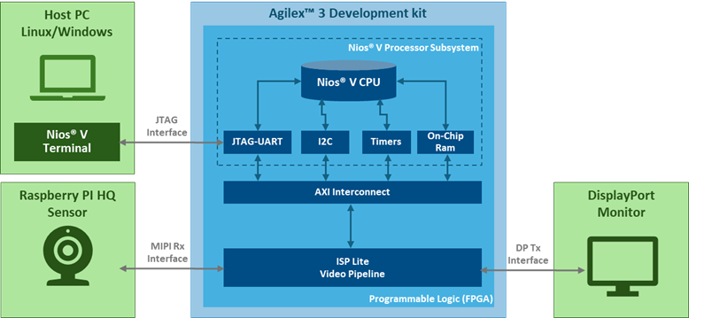
  <br><em>Camera Lite Design—Top-Level Hardware Block Diagram</em>
</p>

---

## Features and Specifications

The example design provides the following features:

* **Input and output video interfaces**
  * Input: MIPI CSI-2
  * Output: DisplayPort 1.4

* **Supported sensor**
  * Raspberry Pi High Quality Camera (IMX477)

* **Supported progressive video resolution on the input and output interfaces**
  * Fixed: 3840 × 2160 at 30 Hz (4Kp30)

* **Video pipeline subsystem**
  * 12-bit raw data from the sensor up to the Demosaic IP
  * 10-bit RGB for video processing
  * VVP ISP IP cores included:
    * [Black Level Correction](https://docs.altera.com/r/docs/683329/25.1/video-and-vision-processing-suite-ip-user-guide/black-level-correction-ip)
    * [White Balance Correction](https://docs.altera.com/r/docs/683329/25.1/video-and-vision-processing-suite-ip-user-guide/white-balance-correction-ip)
    * [Demosaic](https://docs.altera.com/r/docs/683329/25.1/video-and-vision-processing-suite-ip-user-guide/demosaic-ip)
    * [Color Space Converter](https://docs.altera.com/r/docs/683329/25.1/video-and-vision-processing-suite-ip-user-guide/color-space-converter-ip) (Color Correction Matrix)
    * [1D LUT](https://docs.altera.com/r/docs/683329/25.1/video-and-vision-processing-suite-ip-user-guide/about-the-1d-lut-ip)
  * Video Frame Buffer
  * Input video switch:
    * Two inputs and one output
    * Input ports receive data from the sensor and a Test Pattern Generator (TPG)
    * The selected input data is broadcast to the ISP Lite video pipeline
  * Output video mixer:
    * Icon Generator
    * Input video stream
    * TPG

---

## Prerequisites

### Hardware Requirements

The following hardware components are required:

* Supported Development Kits:
  * [Agilex® 3 FPGA and SoC C-Series Development Kit](https://www.altera.com/products/devkit/po-3000/agilex-3-fpga-and-soc-c-series-development-kit)
  * [Agilex® 5 FPGA E-Series 013B Development Kit](https://www.altera.com/products/devkit/po-3196/agilex-5-fpga-e-series-013b-development-kit)
* [Raspberry Pi High Quality Camera with C/CS mount](https://www.raspberrypi.com/products/raspberry-pi-high-quality-camera/)
* [Camera lens compatible with the Raspberry Pi High Quality Camera](https://thepihut.com/collections/raspberry-pi-camera-lenses)
* [Tripod](https://thepihut.com/products/small-tripod-for-raspberry-pi-hq-camera)
* [15-pin to 22-pin MIPI flat cable (20 cm)](https://thepihut.com/products/camera-adapter-cable-for-raspberry-pi-5)
* DisplayPort cable, or an HDMI cable with a [4Kp60 converter dongle](https://www.amazon.co.uk/gp/product/B01M6WK3KU/ref=ppx_yo_dt_b_asin_title_o02_s00?ie=UTF8&th=1)
* USB-C JTAG cable
* 4K monitor or television

#### Related Information

* Other than using different FPGA devices, the Agilex® 3 FPGA and SoC C-Series Development Kit and the Agilex® 5 FPGA E-Series 013B Development Kit are pin compatibles.
The rest of the document will show Agilex® 3 FPGA and SoC C-Series Development Kit figures, but the same connector names and labels apply to the Agilex® 5 FPGA E-Series 013B Development Kit. 

The following figure shows the Agilex® 3 FPGA and SoC C-Series Development Kit.

<p align="center">
  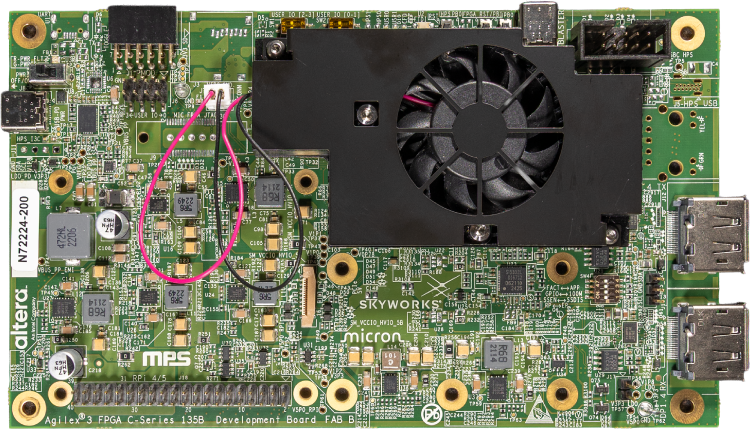
  <br><em>Agilex® 3 FPGA and SoC C-Series Development Kit</em>
</p>

### Software Requirements

The following software tools are required:

* [Altera® Quartus® Prime Pro Edition software version 26.1.1](https://www.altera.com/downloads/fpga-development-tools/quartus-prime-pro-edition-design-software-version-26-1-1-linux)
* Device support for Agilex® 3 and/or Agilex® 5
* [Visual Designer Studio](https://www.altera.com/products/development-tools/visual-designer-studio)
* [FPGA Nios® V Open-Source Tools version 26.1.1](https://www.altera.com/design/guidance/nios-v-developer)

### Repository and Release Tag

The following table lists the source files and release tag for Quartus® Prime Pro Edition software version 26.1.1.

> **Note:** This system example design is provided for demonstration only. The design is not suitable for production or final deployment.

| Agilex® 3 Component | Location | Branch / Tag |
|-----------|----------|--------------|
| Assets release tag | [rel-26.1.1](https://github.com/altera-fpga/agilex3-ed-camera/releases/tag/rel-26.1.1) | `rel-26.1.1` |
| Precompiled SOF | [agilex3_golden_4k_isp_lite_ed.sof](https://github.com/altera-fpga/agilex3-ed-camera/releases/download/rel-26.1.1/agilex3_golden_4k_isp_lite_ed.sof) | `rel-26.1.1` |
| Quartus Project | [agilex3c_a3w135b-dk_4k-isp-lite-ed.zip](https://github.com/altera-fpga/agilex3-ed-camera/releases/download/rel-26.1.1/agilex3c_a3w135b-dk_4k-isp-lite-ed.zip) | `rel-26.1.1` |
| Source code | [Variant for Agilex® 3](https://github.com/altera-fpga/agilex3-ed-camera/tree/rel/26.1.1/agilex3c-ed/a3w135b-dk/4k-isp-lite-ed) | `rel-26.1.1` |

| Agilex® 5 Component | Location | Branch / Tag |
|-----------|----------|--------------|
| Assets release tag | [rel-26.1.1](https://github.com/altera-fpga/agilex3-ed-camera/releases/tag/rel-26.1.1) | `rel-26.1.1` |
| Precompiled SOF | [agilex5_golden_4k_isp_lite_ed.sof](https://github.com/altera-fpga/agilex3-ed-camera/releases/download/rel-26.1.1/agilex5_golden_4k_isp_lite_ed.sof) | `rel-26.1.1` |
| Quartus Project | [Source Code for the Agilex® 5 ED Variant](https://github.com/altera-fpga/agilex3-ed-camera/tree/rel/26.1.1/agilex5e-ed/a5e013b-dk/4k-isp-lite-ed) | `rel-26.1.1` |
| Source code | [Variant for Agilex® 5](https://github.com/altera-fpga/agilex3-ed-camera/tree/rel/26.1.1/agilex5e-ed/a5e013b-dk/4k-isp-lite-ed) | `rel-26.1.1` |


---

## Getting Started

This section describes how to download a precompiled SRAM Object File (.sof) and run the example design on the Agilex® Development Kit.

### Downloading the Precompiled FPGA SOF

The following table lists the precompiled programming file.

| Source | Link | Description | Device Part Number |
|--------|------|-------------|--------------------|
| Agilex® 3 Precompiled SOF | [agilex3_golden_4k_isp_lite_ed.sof](https://github.com/altera-fpga/agilex3-ed-camera/releases/download/rel-26.1.1/agilex3_golden_4k_isp_lite_ed.sof) | SOF for the [Agilex® 3 FPGA and SoC C-Series Development Kit](https://www.altera.com/products/devkit/po-3000/agilex-3-fpga-and-soc-c-series-development-kit) | A3CW135BM16AE6S |
| Agilex® 5 Precompiled SOF | [agilex5_golden_4k_isp_lite_ed.sof](https://github.com/altera-fpga/agilex3-ed-camera/releases/download/rel-26.1.1/agilex5_golden_4k_isp_lite_ed.sof) | SOF for the [Agilex® 5 FPGA E-Series 013B Development Kit](https://www.altera.com/products/devkit/po-3196/agilex-5-fpga-e-series-013b-development-kit) | A5ED013BM16AE4SCS |

### Setting Up the Development Kit

> **Warning:** Handle electrostatic discharge (ESD)-sensitive equipment only when you are properly grounded and working at an ESD-safe workstation.

To set up the development kit, follow these steps:

1. Ensure that the development kit is switched off.

2. Configure the Agilex® Development Kit switches to the factory default positions. For switch settings, refer to the [Agilex® 3 FPGA and SoC C-Series Development Kit User Guide](https://docs.altera.com/r/docs/851698/current/agilex-3-fpga-and-soc-c-series-development-kit-user-guide/default-settings) or the [Agilex® 5 FPGA E-Series 013B Development Kit](https://docs.altera.com/r/docs/860700/current/agilex-5-fpga-e-series-013b-development-kit-user-guide/default-settings).

   The following figures show the switch locations on the development kit.

<p align="center">
  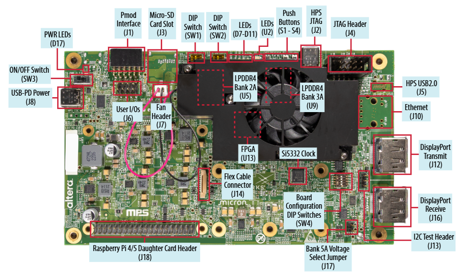
  <br><em>Development Kit—Default Switch Positions (Top View)</em>
</p>

<p align="center">
  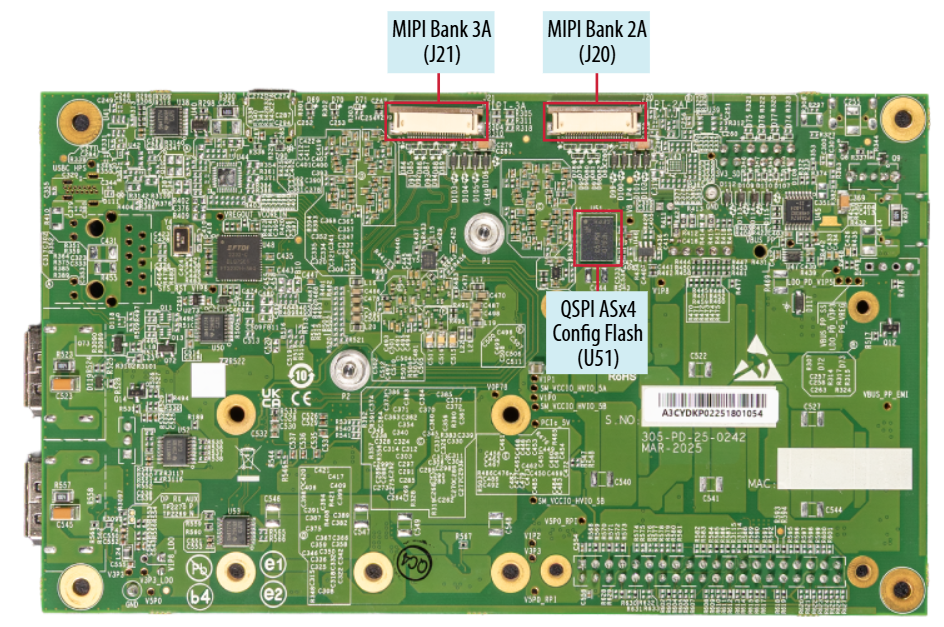
  <br><em>Development Kit—Default Switch Positions (Bottom View)</em>
</p>

3. Connect the following items to the development kit, as shown in the following figures:
   * USB-C power supply (J8)
   * MIPI sensor cable (MIPI Bank 3A—J21)
   * DisplayPort transmit cable (J12)
   * USB-C JTAG cable (J2)

<p align="center">
  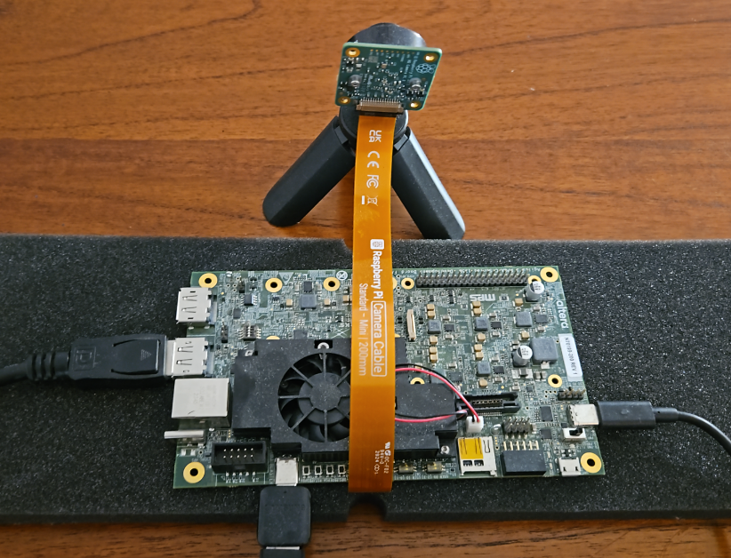
  <br><em>Sensor and Development Kit Connections (1)</em>
</p>

<p align="center">
  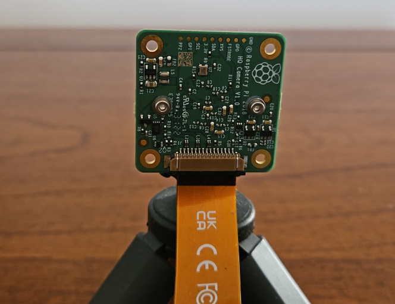
  <br><em>Sensor and Development Kit Connections (2)</em>
</p>

<p align="center">
  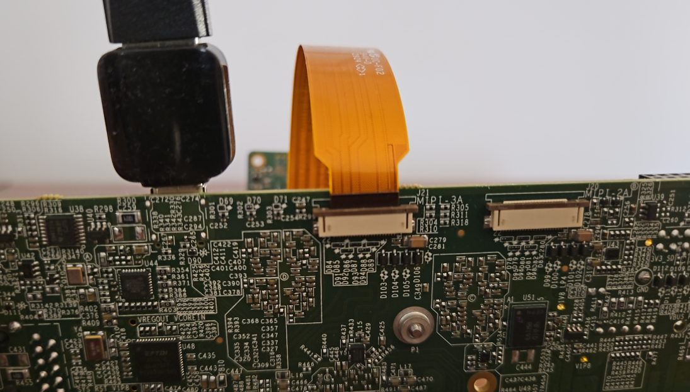
  <br><em>Sensor and Development Kit Connections (3)</em>
</p>

---

## Testing the Example Design on the Development Kit

This section describes how to program the FPGA and run the demonstration software.

### Programming the Development Kit

To program the development kit, follow these steps:

1. Complete the hardware setup described in [Getting Started](#getting-started).

2. Power up the board.

3. Launch the Quartus® Programmer and configure **Hardware Setup** as shown in the following figure.

<p align="center">
  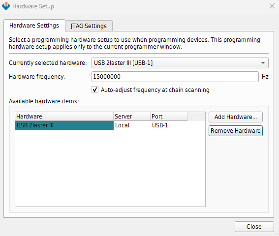
  <br><em>Programmer GUI—Hardware Settings</em>
</p>

4. Click **Auto Detect**, select device `A3CW135BM16A`, and then click **Change File**.

<p align="center">
  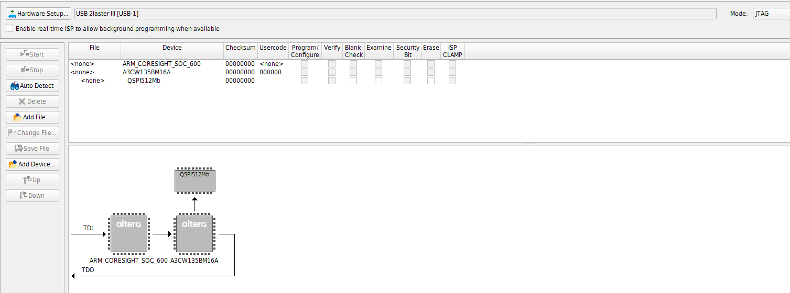
  <br><em>Programmer After Auto Detect</em>
</p>

5. Select the SRAM Object File (for example, `agilex3_golden_4k_isp_lite_ed.sof`).

6. Turn on the **Program/Configure** option, and then click **Start**.

7. Wait until programming completes.

<p align="center">
  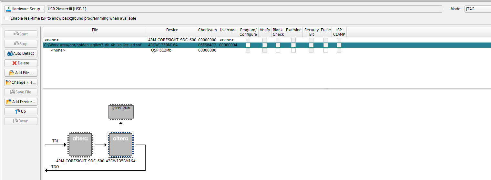
  <br><em>Programming the FPGA with an SRAM Object File</em>
</p>

### Running the Demonstrations

After programming completes, open a JTAG UART terminal.

On Linux, type the following command:

```bash
juart-terminal --instance 0 --device 1
```

On Windows, type the following command:

```bash
juart-terminal.exe --instance 0 --device 1
```

When the connection is successful, the terminal displays the demonstration banner.

<p align="center">
  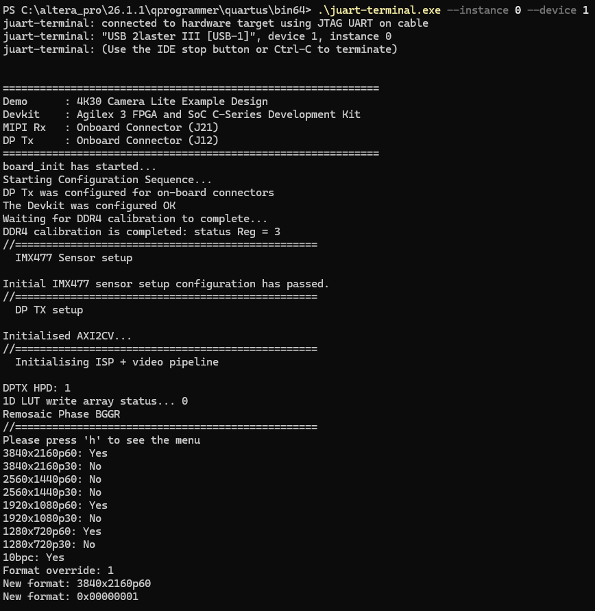
  <br><em>Demonstration Banner</em>
</p>

Press **h** to display the demonstration menu.

<p align="center">
  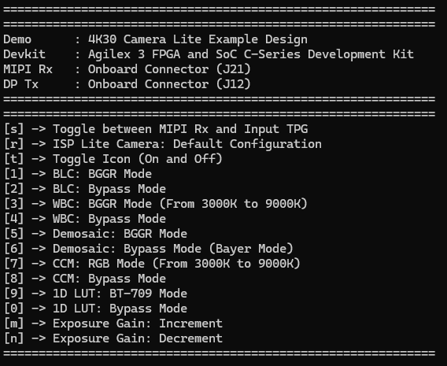
  <br><em>Demonstration Menu</em>
</p>

Each menu option is mapped to a keyboard character. The following table lists the demonstration menu commands.

| Key | Action |
|:---:|--------|
| `h` | Display the help menu |
| `s` | Toggle between MIPI Rx and input TPG |
| `r` | Restore the ISP Lite camera default configuration |
| `t` | Toggle the icon overlay on and off |
| `1` | BLC: BGGR mode |
| `2` | BLC: Bypass mode |
| `3` | WBC: BGGR mode (3000 K to 9000 K) |
| `4` | WBC: Bypass mode |
| `5` | Demosaic: BGGR mode |
| `6` | Demosaic: Bypass mode (Bayer mode) |
| `7` | CCM: RGB mode (3000 K to 9000 K) |
| `8` | CCM: Bypass mode |
| `9` | 1D LUT: BT.709 mode |
| `0` | 1D LUT: Bypass mode |
| `m` | Exposure gain: Increment |
| `n` | Exposure gain: Decrement |

Use the menu commands as follows:

* Press `s` to toggle between MIPI Rx and the input TPG.
  The input TPG is preconfigured to support four patterns:
  * Color bars
  * Solid colors: blue, green, and red

<p align="center">
  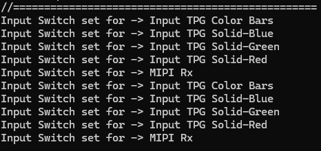
</p>

* Press `r` to restore the ISP video pipeline to its default configuration.

<p align="center">
  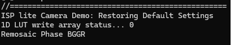
</p>

* Press `t` to toggle the icon overlay on and off.

<p align="center">
  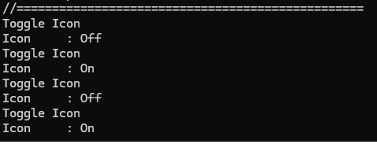
</p>

* Press `1` to enable BLC. Press `2` to place BLC in bypass mode.

<p align="center">
  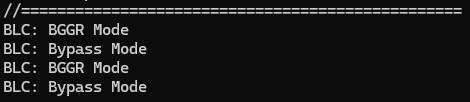
</p>

* Press `3` to enable WBC. Press `4` to place WBC in bypass mode.
  * When WBC is enabled, you can step the color temperature from 3000 K to 9000 K in 1000 K increments.

<p align="center">
  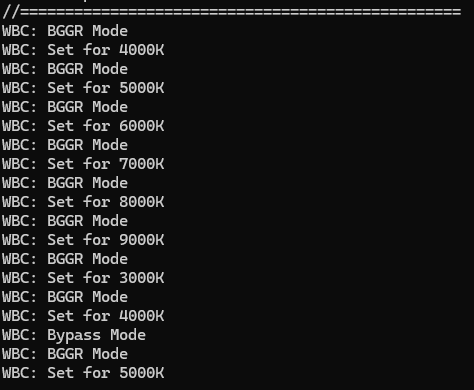
</p>

* Press `5` to enable the Demosaic IP. Press `6` to place the Demosaic IP in bypass mode.

<p align="center">
  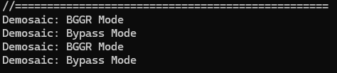
</p>

* Press `7` to enable the CCM. Press `8` to place the CCM in bypass mode.
  * When the CCM is enabled, you can step the color temperature from 3000 K to 9000 K in 1000 K increments.

<p align="center">
  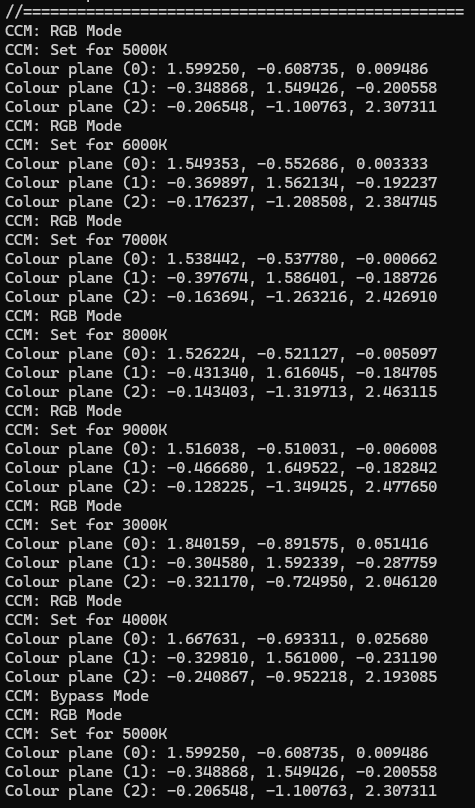
</p>

* Press `9` to enable the 1D LUT. Press `0` to place the 1D LUT in bypass mode.
  * When the 1D LUT is enabled, the design applies a BT.709 gamma curve.

<p align="center">
  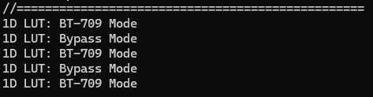
</p>

* Press `m` to increase the sensor exposure gain. Press `n` to decrease the sensor exposure gain.
  * When you increase the gain, the software application first increases the digital gain. After the digital gain reaches its maximum limit, the application increases the analog gain.
  * When you decrease the gain, the software application first decreases the analog gain. After the analog gain reaches zero, the application decreases the digital gain.

<p align="center">
  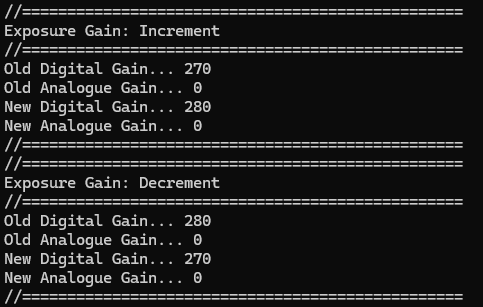
</p>

---

## Compiling the Example Design from Scratch

This section describes how to compile the example design in the Quartus® Prime Pro Edition software and generate an SRAM Object File (.sof).

To compile the example design, follow these steps:

1. Download the example design from the repository listed in the following table.

| Component | Location | Branch / Tag |
|-----------|----------|--------------|
| Agilex® 3 Assets release tag | [rel-26.1.1](https://github.com/altera-fpga/agilex3-ed-camera/releases/tag/rel-26.1.1) | `rel-26.1.1` |
| Agilex® 5 Assets release tag | [rel-26.1.1](https://github.com/altera-fpga/agilex3-ed-camera/releases/tag/rel-26.1.1) | `rel-26.1.1` |

2. Extract the package.

3. Confirm that the FPGA design files are in `src/vds/`, `src/rtl/`, and `src/ip/`.

4. Confirm that the software files are in `src/sw/`.

   The example design directory structure is as follows:

```text
<Example Design>/
├── top.qpf                  # Quartus project file
├── top.qsf                  # Quartus settings file
├── README.md                # Repository readme
├── docs/                    # User guide for this example design
├── output_files/            # Precompiled SOF
├── scripts/                 # Scripts used to generate the example design
└── src/
    ├── custom_ip/           # Non-QPDS IP
    ├── ip/                  # .ip files
    ├── rtl/                 # RTL files
    ├── sdc/                 # SDC files
    ├── sw/                  # Bare-metal software application
    └── vds/                 # Tcl to generate the Visual Designer Studio (VDS) project
```

5. Launch the Quartus® Prime Pro Edition software.

6. Open `<Example Design>/top.qpf`.

7. On the **Processing** menu, click **Start Compilation**.

8. Wait until compilation completes.

After a successful compilation, the Quartus® Prime software generates the programming file in the `<Example Design>/output_files/` directory:

* `top.sof`

### Recompiling the Nios® V Software Application

To rebuild the Nios® V software application and merge it into the .sof, type the following commands:

```bash
cd <Example Design>/scripts/
quartus_sh -t post_swapp_gen.tcl
```

The script compiles the Nios® V application, merges the generated hexadecimal (HEX) ROM into the project, and generates an updated `top.sof` that contains the latest software.

---

## Functional Description

For a description of the video pipeline and IP cores used in this Camera Lite example design, refer to [Functional Description](./camera-lite-funct-descr.md).

---

## Additional Information

* [Design Security Considerations](./design-security-considerations.md)
* [Acronyms and Terminology](./glossary.md)

---

## Related Documents

* [Agilex® 3 FPGA and SoC C-Series Development Kit User Guide](https://docs.altera.com/r/docs/851698/current/agilex-3-fpga-and-soc-c-series-development-kit-user-guide/overview)
* [Agilex® 5 FPGA E-Series 013B Development Kit](https://docs.altera.com/r/docs/860700/current/agilex-5-fpga-e-series-013b-development-kit-user-guide/overview)
* [Raspberry Pi High Quality Camera with C/CS mount](https://www.raspberrypi.com/products/raspberry-pi-high-quality-camera/)
* [Video and Vision Processing Suite Altera® FPGA IP User Guide](https://www.altera.com/products/ip/po-3150/video-and-vision-processing-suite)
* [Altera® FPGA Streaming Video Protocol Specification](https://docs.altera.com/r/docs/683397/current/altera-streaming-video-protocol-specification/about-the-altera-streaming-video-protocol)
* [AMBA 4 AXI4-Stream Protocol Specification](https://developer.arm.com/documentation/ihi0051/a/)
* [MIPI CSI-2 IP User Guide](https://docs.altera.com/r/docs/813926/26.1.1/mipi-csi-2-ip-user-guide/about-the-mipi-csi-2-ip)
* [DisplayPort IP User Guide](https://docs.altera.com/r/docs/683273/25.3/displayport-ip-user-guide/displayport-ip-quick-reference)
* [Visual Designer Studio](https://www.altera.com/products/development-tools/visual-designer-studio)
* [Nios® V Processor](https://www.altera.com/products/ip/po-3098/nios-v-processors)

---

## Notices & Disclaimers

Altera<sup>&reg;</sup> Corporation technologies may require enabled hardware, software or service activation.
No product or component can be absolutely secure.
Performance varies by use, configuration and other factors.
Your costs and results may vary.
You may not use or facilitate the use of this document in connection with any infringement or other legal analysis concerning Altera or Intel products described herein. You agree to grant Altera Corporation a non-exclusive, royalty-free license to any patent claim thereafter drafted which includes subject matter disclosed herein.
No license (express or implied, by estoppel or otherwise) to any intellectual property rights is granted by this document, with the sole exception that you may publish an unmodified copy. You may create software implementations based on this document and in compliance with the foregoing that are intended to execute on the Altera or Intel product(s) referenced in this document. No rights are granted to create modifications or derivatives of this document.
The products described may contain design defects or errors known as errata which may cause the product to deviate from published specifications. Current characterized errata are available on request.
Altera disclaims all express and implied warranties, including without limitation, the implied warranties of merchantability, fitness for a particular purpose, and non-infringement, as well as any warranty arising from course of performance, course of dealing, or usage in trade.
You are responsible for safety of the overall system, including compliance with applicable safety-related requirements or standards.
<sup>&copy;</sup> Altera Corporation. Altera, the Altera logo, and other Altera marks are trademarks of Altera Corporation. Other names and brands may be claimed as the property of others.

OpenCL* and the OpenCL* logo are trademarks of Apple Inc. used by permission of the Khronos Group™.
